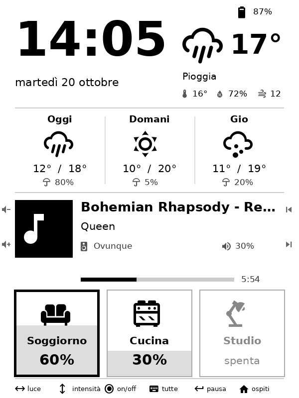
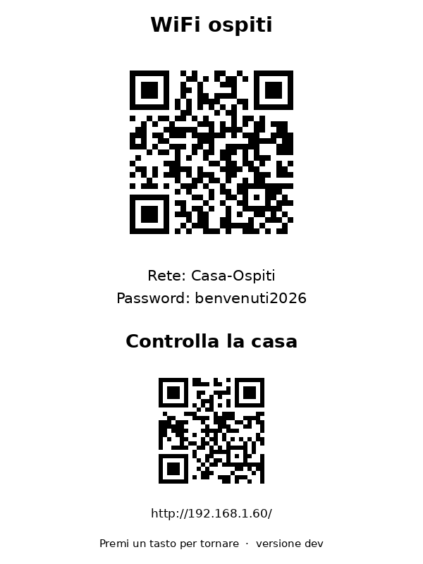
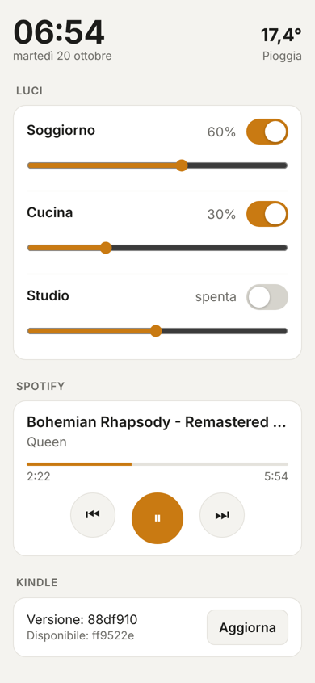

# Kindle 5 home panel

A Kindle 5 (2012, non-touch) hanging on the wall that shows the time, the
weather and Spotify, and uses its physical keys to control the 3 lights of a
Shelly Plus RGBW PM. The Home key shows QR codes for the guest WiFi and for a
webapp that does the same things from a phone. An Arduino UNO R4 WiFi acts as
an HTTPS gateway (the Kindle can't do modern TLS), serves the webapp and, as an
Arduino Cloud device, tells you when the power goes out.

> **Language.** Code and docs are in English; the text shown on the Kindle and
> in the webapp is in Italian. The on-screen strings live in
> `kindle/dashboard.sh`, `kindle/defaults.sh` (`LEGEND_KEYS_*`),
> `arduino/kindle_gateway/webapp.h` and the date/weather tables at the top of
> `kindle_gateway.ino`, if you want to translate them.

  

```
Spotify, Open-Meteo ◄─HTTPS── UNO R4 WiFi ──► Arduino Cloud (notifies when offline)
                               ▲    ▲    │
             HTTP /status, /cmd│    │    │ HTTP (lights from the webapp and for /status)
                               │    │    ▼
                        Kindle 5    │   Shelly Plus RGBW PM
                               │    │    ▲
                               │  phone (webapp, http://ARDUINO_IP/)
                               └─────────┘ HTTP (lights from the keys)
```

| Folder | Contents |
|---|---|
| `arduino/kindle_gateway/` | Sketch for the UNO R4 WiFi |
| `kindle/` | Panel scripts, to copy into `/mnt/us/dashboard/` on the Kindle |
| `tools/get_spotify_token.py` | Gets the Spotify refresh token (once, on your computer) |
| `tools/make_qr.py` | Generates the QR codes for the guest WiFi and the webapp |
| `tools/make_icons.py` | Generates the icon font used on the Kindle screen |
| `tools/release_kindle.sh` | Publishes an OTA update for the Kindle (`kindle-vN` tag) |
| `tools/preview.py` | Previews the Kindle screen on your computer |
| `tools/webapp_dev.py` | Previews the webapp in the browser, with fake APIs |

## Keys

The joystick controls the lights, the page keys on the sides the music playing
at home.

| Key | Action |
|---|---|
| Joystick left / right | Picks the light (the tile with the thick black frame) |
| Joystick up / down | Brightness of the selected light + / − |
| Joystick center | Switches the selected light on / off |
| Left page keys (forward / back) | Volume + / − |
| Right page keys (forward / back) | Next / previous track |
| Back | Pause; if nothing is playing at home, starts the music |
| Keyboard | Switches all lights off (or back on) |
| Menu | Full screen refresh |
| Home | Shows the QR codes (guest WiFi and webapp) |

**Music "at home".** Only music playing on a Spotify device of type `Speaker`
counts (Echos; `SPOTIFY_HOME_TYPE` in `home_config.h`): if you're listening on
your phone away from home, the panel ignores it and the keys leave it alone.
The Back key resumes the music where it left off on the `SPOTIFY_HOME_DEVICE`
device (a group works too), moving it there if it's playing elsewhere; if
there's nothing to resume, `SPOTIFY_FALLBACK_CONTEXT` starts, if set.

With the QR codes on screen any key goes back to the panel without doing
anything else. The screen also closes by itself after 2 minutes
(`QR_SECONDS`). The bottom strip summarizes the keys and changes depending on
whether music is playing (`LEGEND_KEYS_MUSIC`, `LEGEND_KEYS_IDLE` in
`defaults.sh`, can be redefined in `config.sh`). While music plays, small icons
on the edges of the screen, next to the page keys, show what they do.

Each light is a tile: the gray fills it from the bottom as far as the
brightness. Its icon is set in `LIGHT_ICONS` (`sofa`, `kitchen`, `desk`,
`bulb`, `ceiling`, `floor`, `bed`, `tv`, `strip`).

Holding down brightness or volume keeps changing the value. Only the last
value is sent to the Shelly and to Spotify, once the keys stop (debounce).
"−" at the minimum switches the light off, "+" on a light that's off switches
it on at the minimum.

## 1. Network

- Reserve a fixed IP in your router for the UNO R4 and one for the Shelly.
- Shelly: **Light** profile (4 channels). The 3 lights are on channels 0, 1
  and 2 (configurable in `config.sh` on the Kindle). Shelly authentication
  must be off, because the scripts call its API without a password.

## 2. Spotify

1. Go to <https://developer.spotify.com/dashboard> and create an app:
   - API: **Web API**
   - Redirect URI: `http://127.0.0.1:8888/callback`
2. On your computer run `python3 tools/get_spotify_token.py`, enter the Client
   ID and Client Secret and authorize in the browser. The script prints the
   refresh token.

Play, pause and skipping tracks need Spotify Premium and an active device
(phone, computer, speaker…).

## 3. Arduino UNO R4 WiFi

1. Update the WiFi module firmware (IDE → Tools → Firmware Updater).
2. Copy `arduino_secrets.h.example` to `arduino_secrets.h` and fill in the
   Spotify Client ID, Client Secret and refresh token. WiFi doesn't go here:
   Arduino Cloud configures it. The GitHub token is only needed if the OTA
   repository is private (see [Kindle OTA updates](#kindle-ota-updates)).
3. Copy `home_config.h.example` to `home_config.h` and set `LATITUDE` and
   `LONGITUDE`, then `SHELLY_HOST` and `LIGHTS` (light names and channels for
   the webapp, the same as on the Kindle). If you publish your own releases
   from a fork, also set `OTA_GITHUB_REPO`. Like `arduino_secrets.h`, it's kept
   out of git. In the Cloud Editor, add it as a new tab of the sketch.
4. Libraries: **ArduinoIoTCloud** (with its dependencies) and **ArduinoJson** 7.
5. Upload the sketch from the Cloud Editor, or from the IDE if the board is
   already associated with the Thing. `thingProperties.h` is the one generated
   by your Thing.
6. Read the address from the Serial Monitor (9600 baud) and open it in a browser:
   - `http://ARDUINO_IP/` is the webapp;
   - `http://ARDUINO_IP/status` should show `key=value` lines;
   - `http://ARDUINO_IP/log` shows free memory and the latest errors.

The Arduino Cloud trigger on the device status stays as it is. The sketch
calls `ArduinoCloud.update()` on every loop and does at most one HTTPS
operation at a time, so the device doesn't show up as offline for no reason.

**Thing variables.** The Thing has six diagnostic variables, all read-only
(they're in `thingProperties.h`, which must match the Thing):

| Variable | Type | Meaning |
|---|---|---|
| `uptimeMin` | INT | minutes since boot: if it drops back to 0 the board restarted |
| `lastError` | CHARSTRING | latest error (weather, Spotify, watchdog) |
| `lastReset` | CHARSTRING | reason for the last restart: power on, watchdog, software |
| `weatherOk` | STATUS | the last weather update succeeded |
| `spotifyOk` | STATUS | Spotify is answering |
| `kindleOnline` | STATUS | the Kindle requested `/status` in the last 2 minutes (or announced a pause) |

You can put a trigger on `kindleOnline`, as for the device status, to know
when the panel goes off.

**Watchdog.** If `loop()` stays stuck for a minute, the hardware watchdog
resets the board. If the Cloud stays disconnected for 10 minutes, even with
WiFi down, the board restarts itself, which also resets the WiFi module.
After the restart `lastReset` reports why.

**Memory.** The UNO R4 has 32 KB of RAM and the sketch is at the limit. These
choices are deliberate, measured on the board:
- `setup()` and `loop()` run on a 2.5 KB stack owned by the sketch (the core
  gives 1 KB, but JSON parsing reaches ~1.7 KB and spilled into the heap);
- HTTPS requests use `ChunkedSSLClient`, which reads 512 bytes at a time from
  the WiFi module: with `WiFiSSLClient`'s 1023, a fragmented heap makes the
  allocation fail and the board hangs;
- requests are written in small pieces from a static buffer, without `String`
  concatenations;
- small responses (weather, Spotify token) are read in full before parsing;
- no Bluetooth agent in the Network Configurator: it cost ~1.6 KB. To change
  WiFi network, connect the board over USB and configure it from the Cloud.

If you change the sketch, watch the `Memory:` line it prints on serial every
5 minutes (free stack and heap), or open `/log`.

## 4. Kindle

> **Mind the names.** On MobileRead "K5" means the Kindles with firmware 5.x
> (the touch ones). The Kindle 5 has firmware 4.1.x, so it needs the packages
> for **K4 / legacy**.

1. **Jailbreak.** Use the jailbreak for the non-touch Kindle 4/5 from NiLuJe's
   thread on MobileRead (Kindle Developer's Corner) and follow the package's
   README.
2. **USBNetwork.** Install it from the same thread and enable SSH over WiFi.
3. **FBInk.** The one from KOReader's `kindle-legacy` build works (GitHub
   release, file `koreader/fbink`): copy it to `/mnt/us/dashboard/bin/fbink`.
   That build can't draw images, which is why the QR codes are copied into the
   framebuffer from the `.raw` files made by `make_qr.py`.
4. **Fonts.** Copy `DejaVuSans.ttf` and `DejaVuSans-Bold.ttf` to
   `/mnt/us/dashboard/fonts/`. Other fonts work too, just point to them in
   `config.sh` (`FONT`, `FONT_BOLD`). For the icons, run
   `python3 tools/make_icons.py` on your computer (needs `pip install
   fonttools`) and copy the `kindle/fonts/icons.ttf` it creates there too.
   It holds only the ~60 icons the panel uses, taken from
   [Material Design Icons](https://pictogrammers.com/library/mdi/) (Apache
   2.0) and moved onto plain letters, so the shell scripts and FBInk only deal
   with ASCII. Without it the panel works the same, just without icons. OTA
   updates don't touch fonts: if a release adds icons, regenerate it.
5. Copy the files listed in `kindle/ota-files` to `/mnt/us/dashboard/`:
   `lib.sh`, `defaults.sh`, `dashboard.sh`, `ota.sh` and `ota-files`. Then copy
   `kindle/config.example.sh` as `config.sh` and set the IPs and light names.
   - `defaults.sh` holds all the default values and is replaced by OTA
     updates: don't edit it.
   - `config.sh` holds only what you change and is never touched.

   A complete `config.sh` copied from an older version still works: it's read
   after `defaults.sh` and overrides its values. You can then trim it down to
   the lines you actually customized.
6. **QR codes.** On your computer run `pip install segno` and then
   `python3 tools/make_qr.py`. It asks for the guest WiFi network and password
   and creates `kindle/qr/`. Copy the folder to `/mnt/us/dashboard/qr/`. It
   holds the password in clear text, which is why it's kept out of the
   repository.
7. **Check the keys.** Over SSH run:
   ```sh
   sh /mnt/us/dashboard/dashboard.sh keytest
   ```
   Press every key and compare the codes with those in `defaults.sh`; if they
   differ, redefine them in `config.sh`. Check the devices in `INPUT_DEVICES`
   too.
8. Start and stop:
   ```sh
   sh /mnt/us/dashboard/dashboard.sh start   # stops the Kindle UI and starts the panel
   sh /mnt/us/dashboard/dashboard.sh stop    # back to the normal Kindle
   ```
   The log is in `/tmp/dashboard.log`.
9. **Start at boot.**
   ```sh
   sh /mnt/us/dashboard/dashboard.sh autostart on    # off to remove it
   ```
   Installs `/etc/init.d/dashboard` (started as `S99dashboard`): at boot it
   waits for WiFi and starts the panel, in the background, without blocking
   the boot. To skip one start, create `/mnt/us/dashboard/NO_AUTOSTART`. To
   keep SSH reachable after a reboot, in `usbnet/` rename `DISABLED_auto` to
   `auto` and put `K3_WIFI_SSHD_ONLY="true"` in `usbnet/etc/config`: only SSH
   starts and the Kindle stays visible as a USB drive.

## Power and pause

The panel keeps the Kindle always on: without the suspend of normal use, the
battery lasts days rather than weeks. The real drain is WiFi, far more than
screen refreshes. That's why:
- the time keeps going on the Kindle's internal clock, calibrated against the
  Arduino's on every `/status` (the Kindle's time zone doesn't matter);
- the Arduino is asked for the state once a minute; every `POLL_SECONDS`
  (10 s) only while music is playing or the Kindle is charging;
- the lights come inside `/status` (the Arduino reads them from the Shelly);
  with an older gateway the Kindle still asks the Shelly, on every `/status`;
- between requests the panel's processes sleep, with no idle wake-ups;
- the full refresh against ghosting runs every 4 hours (`FULL_REFRESH_MINUTES`).

**Pause.** If nothing changes for `IDLE_MINUTES` (10), the panel turns WiFi
off. "Nothing" means: no key, same lights and music, no track playing. While
paused the time keeps going and the bottom strip says how old the data is.
Every `SLEEP_CHECK_MINUTES` (15), and at midnight for the date, WiFi comes
back on for a `/status`. If something changed meanwhile, for example a light
switched on from a phone, the panel stays awake; otherwise it pauses again. A
key wakes it right away, without doing anything else. While charging it never
pauses. Before turning WiFi off, the Kindle tells the gateway, so it isn't
reported as off (`kindleOnline`). To disable the pause, put `IDLE_MINUTES=0`
in `config.sh`.

**Measuring.** Every 30 minutes the panel notes the battery in
`/mnt/us/dashboard/battery.log` (`BATTERY_LOG_MINUTES`): seconds, time, level,
current in mA (negative on battery) and `pause`/`awake` when the state
changes. From there you can work out how much it draws awake and paused.

## Kindle OTA updates

The Kindle updates itself, but only when you publish a **release**, i.e. a
`kindle-vN` tag. A push to `main` alone doesn't update it: you can change the
README, the sketch or even `kindle/` without the Kindle restarting, and decide
when a version is ready. The Kindle doesn't speak HTTPS, so the files go
through the Arduino, which reads them from GitHub:

```
Kindle ──HTTP /ota/version, /ota/file──► UNO R4 ──HTTPS──► GitHub
```

**Which repository.** `OTA_GITHUB_REPO` in `home_config.h`, by default
`balsick/kindle-homeview`. If you fork the project and publish your own
releases, point it at your fork; set it to `""` to turn OTA off on the
Arduino side.

**Publishing an update.** Push to `main`, then run:

```sh
tools/release_kindle.sh
```

The script:
1. checks that `kindle/` has no uncommitted changes and that the commit is
   already on GitHub;
2. finds the latest `kindle-vN`. If `kindle/` hasn't changed since, it does
   nothing;
3. runs the same checks as the Kindle: final `# ota:end` line and `sh -n` on
   the scripts;
4. shows the changes, asks for confirmation and publishes `kindle-vN+1`.

The Kindle always moves to the tag with the highest number, compared as a
number: `kindle-v10` comes after `kindle-v9`. It never goes back to a lower
number, even if you delete a tag. To undo a bad release, publish a fixed
version with a higher number.

**Token.** A public repository needs no token: requests are anonymous, and a
check uses a handful of GitHub's 60 requests per hour. For a private
repository, go to *Settings → Developer settings → Fine-grained tokens* on
GitHub and create a token with:
- access to that repository only;
- *Contents: Read-only* permission.

Put it in `SECRET_GITHUB_TOKEN` in `arduino_secrets.h`. Either way the Arduino
only relays files of the `kindle/` folder at `kindle-vN` tags, not the rest of
the repository.

**When it checks.** Two minutes after startup, then every 24 hours
(`OTA_CHECK_HOURS`). You can force a check in two ways:
- with the webapp's *Aggiorna* (update) button, which also shows the version
  running on the Kindle and the latest available;
- over SSH, with output on the terminal: `sh /mnt/us/dashboard/dashboard.sh update`.

The running version also shows at the bottom of the QR screen. The log is in
`/tmp/dashboard-ota.log`.

**What gets updated.** Only the files listed in `kindle/ota-files`. These are
never touched:
- `config.sh`;
- the QR codes;
- FBInk;
- the fonts.

Every updatable file must end with the line `# ota:end`. If you add a file,
add it to `ota-files` too.

**Safeguards.**
1. Files are downloaded separately and accepted only if complete (the final
   `# ota:end` line is there). Scripts must also pass the syntax check
   (`sh -n`). If a single file fails, the update is cancelled without touching
   anything.
2. The running version is saved in `.ota_prev/` before being replaced.
3. After the restart the panel must prove it works within 45 seconds
   (`OTA_HEALTH_SECONDS`). If it doesn't, the previous version is restored.
   The broken release is written to `.ota_bad` and never retried.

The check and the rollback are done by the old version's process, so they
work even if the new version is broken. One case remains uncovered: a new
version that starts but has broken OTA can't update itself. That one gets
fixed over SSH.

To disable OTA on the Kindle, put `OTA_ENABLED=0` in `config.sh`.

### Things to know on the device

Tested on a Kindle 5 (firmware 4.1.4) with KOReader's FBInk:
- the Kindle's BusyBox is 1.7.2: no `od`, no `command -v`, `grep` without
  `-E`. The scripts use `hexdump`, `which` and plain `grep`;
- the key codes in `defaults.sh` are the ones measured on this Kindle
  (different from KOReader's keymap for the page keys): if yours gives
  something else, `keytest` shows the codes and you redefine them in
  `config.sh`;
- USBNetwork: with SSH over WiFi (`K3_WIFI="true"`) the package's dropbear
  only accepts RSA keys, not ed25519;
- from macOS, the `._*` files Finder leaves on the Kindle's drive make `.bin`
  updates fail (error U007): delete them first;
- still to verify: WiFi with the framework stopped for many hours.

## Webapp

Served by the UNO R4 at `http://ARDUINO_IP/`, LAN only. It also opens from
the Kindle's second QR code. It shows the time and weather, controls the
lights (switch and slider) and Spotify.

The lights go from the Arduino to the Shelly. The Kindle re-reads the lights
on every `/status`, so a change from the phone shows up on the screen within
a minute (10 s while music is playing).

**Security.** The webapp has no password: anyone on your network can switch
the lights. For guests, use an **isolated guest network**: with the first QR
code they get Internet, but they can't reach the webapp.

To edit it: `python3 tools/webapp_dev.py`, open `http://localhost:8000/`,
edit `arduino/kindle_gateway/webapp.h` and reload the page.

## UI preview

```sh
pip install pillow
python3 tools/preview.py               # creates preview.png
python3 tools/preview.py --watch       # regenerates it on every change to dashboard.sh/defaults.sh/config.sh
python3 tools/preview.py --screen qr   # QR screen (preview-qr.png)
```

The preview runs the real `dashboard.sh` and intercepts the calls to FBInk.
The layout is changed in `dashboard.sh`:
- zone coordinates (`CLK_Y`, `WX_Y`, …);
- the `draw_*` functions;
- the icon table (`I_name=character  # mdi-name`), from which
  `make_icons.py` builds the font.

What KOReader's FBInk can draw, and what the panel uses:
- TrueType text (`-t`) in any font, black, white or one of 14 grays
  (`-C GRAY1` … `GRAYE`), without background (`-O`) so it can sit on boxes;
- filled rectangles in the same 16 colors (`-k` with `-B`): lines, tiles,
  the progress bar, the "cover" of the music;
- icons, as text in an icon font;
- no images (PNG/JPEG): that's why the QR codes are copied into the
  framebuffer from `.raw` files.

The preview follows FBInk's font size (`px` is the height from ascender to
descender) and grays; the gray levels on e-ink look a bit different.

Sample data is in `tools/sample_status.txt`. `--lights` changes the light
states, for example `--lights "1:100 0:50 1:20"`.

## Contributing and license

See [CONTRIBUTING.md](CONTRIBUTING.md). Released under the [MIT License](LICENSE).
